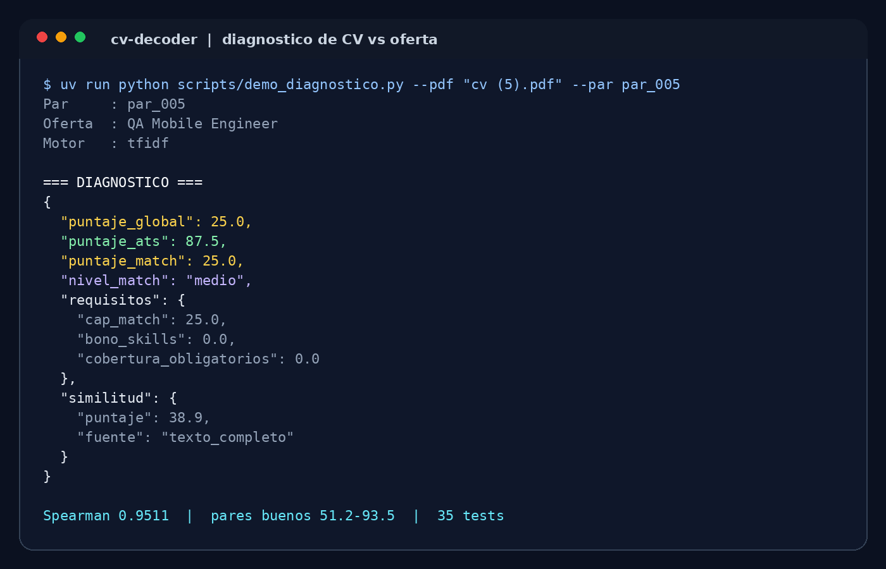
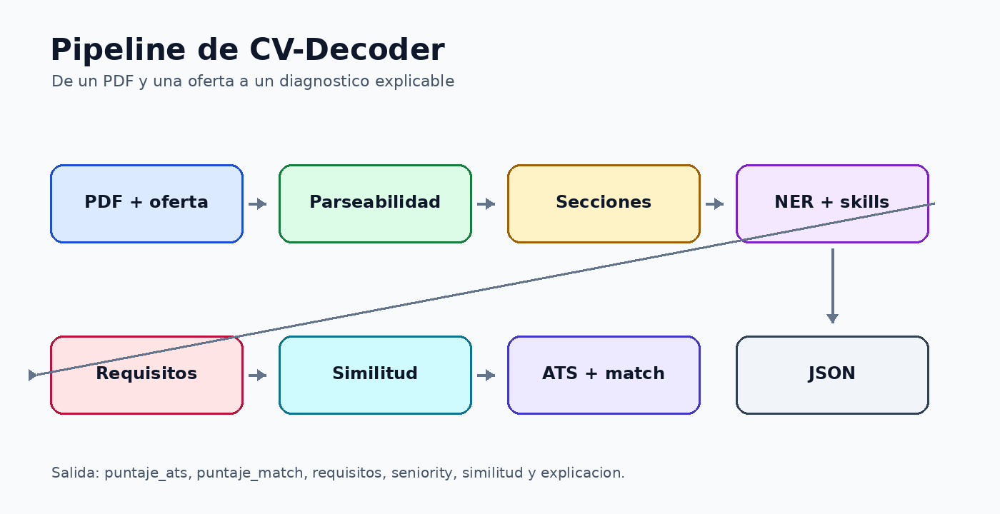
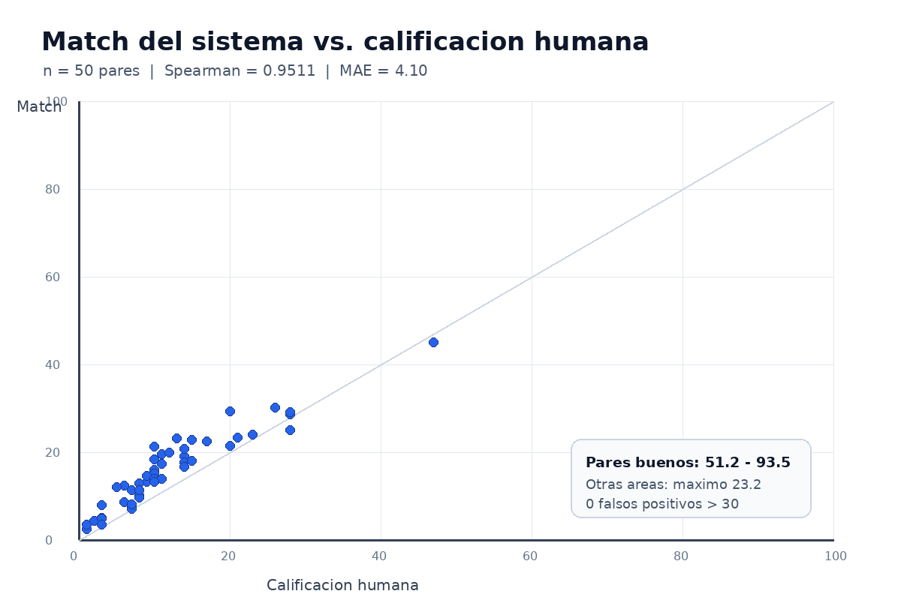

<div align="center">

# CV-Decoder

### Diagnóstico de CVs y optimización ATS multilingüe para postulantes y equipos de selección.

[](https://www.python.org/)
[](LICENSE)
[]()

[Demo en vivo](https://maxiteyo.github.io/CV-Decoder/) · [Repositorio](https://github.com/maxiteyo/CV-Decoder) · [Reportar un bug](https://github.com/maxiteyo/CV-Decoder/issues)

</div>

---

## Tabla de contenidos

- [Demo](#demo)
- [Sobre el proyecto](#sobre-el-proyecto)
  - [Contexto académico](#contexto-académico)
  - [Construido con](#construido-con)
- [El dataset](#el-dataset)
- [Metodología](#metodología)
- [Resultados](#resultados)
- [Estructura del proyecto](#estructura-del-proyecto)
- [Instalación](#instalación)
- [Uso](#uso)
- [Roadmap](#roadmap)
- [Autores](#autores)
- [Licencia](#licencia)
- [Agradecimientos y referencias](#agradecimientos-y-referencias)

---

## Demo

El MVP devuelve un diagnóstico estructurado en JSON a partir de un CV en PDF y el texto de una oferta laboral. La demostración pública es una página estática con el resumen del proyecto, las métricas principales y un ejemplo de salida; la interfaz interactiva queda para la etapa de trabajo final.



**Demo en vivo:** https://maxiteyo.github.io/CV-Decoder/

La página se publica con GitHub Pages desde la rama `main`, carpeta `/docs`. La API se puede probar localmente con Swagger en `http://127.0.0.1:8000/docs`; las instrucciones están en [Uso](#uso).

---

## Sobre el proyecto

CV-Decoder es un sistema de Procesamiento de Lenguaje Natural (NLP) que audita un currículum en PDF contra una oferta de trabajo. El objetivo es responder dos preguntas que suelen mezclarse en las herramientas ATS: si el CV está bien armado como documento y si se adecúa realmente al puesto al que se postula.

El sistema extrae texto del PDF, mide su parseabilidad, detecta secciones, reconoce entidades y habilidades, y compara el contenido del CV con la oferta. A partir de eso devuelve dos puntajes independientes: `puntaje_ats` (calidad del documento) y `puntaje_match` (compatibilidad con la vacante), acompañados por el detalle de requisitos cumplidos, requisitos faltantes, similitud y nivel de compatibilidad.

El enfoque prioriza explicabilidad y reproducibilidad: usa TF-IDF calibrado como motor principal de similitud, spaCy para entidades y reglas explícitas para requisitos, secciones, seniority y brecha de habilidades. Los embeddings multilingües se evaluaron, pero se descartaron porque ordenaban peor los pares calificados por personas.

**Estado actual:** MVP funcional con API REST. El trabajo final incorporará una interfaz de presentación más completa y las mejoras pendientes del roadmap.

### Contexto académico

- **Asignatura:** Inteligencia Artificial (2026)
- **Institución:** Centro Regional Universitario Córdoba - IUA | Universidad de la Defensa Nacional
- **Cohorte / año:** 2026
- **Docente:** Ing. González, Hernando Alexis
- **Modalidad:** grupal

### Construido con

- [Python 3.12](https://www.python.org/)
- [FastAPI](https://fastapi.tiangolo.com/)
- [spaCy](https://spacy.io/)
- [scikit-learn](https://scikit-learn.org/)
- [pdfminer.six](https://pdfminersix.readthedocs.io/) y [pdfplumber](https://github.com/jsvine/pdfplumber)
- [pandas](https://pandas.pydata.org/) y [NumPy](https://numpy.org/)
- [pytest](https://pytest.org/)
- [uv](https://docs.astral.sh/uv/)

---

## El dataset

El proyecto combina datasets públicos de Kaggle con un benchmark interno construido por el equipo. Los archivos pesados y los CVs reales no se versionan: se descargan o regeneran siguiendo la [guía de uso](docs/informe/guia-de-uso.md).

| Campo | Detalle |
|---|---|
| Fuente | [DataTurks Resume NER](https://www.kaggle.com/datasets/dataturks/resume-entities-for-ner), [LinkedIn Job Postings](https://www.kaggle.com/datasets/arshkon/linkedin-job-postings), [1.3M LinkedIn Jobs & Skills](https://www.kaggle.com/datasets/asaniczka/1-3m-linkedin-jobs-and-skills-2024) y benchmark interno del equipo. |
| Registros | Aproximadamente 220 CVs anotados para NER; 221 PDFs reales y 60 PDFs sintéticos de control en el benchmark; ofertas y habilidades en archivos CSV. |
| Variables | Texto del CV, tokens y etiquetas NER, texto de la oferta, habilidades y puntaje humano de compatibilidad. |
| Variable objetivo | Etiquetas de entidades para la extracción; puntaje de compatibilidad CV-oferta para el match. |
| Período / cobertura | Los datasets públicos no declaran un período uniforme; el benchmark interno corresponde a 2026. |
| Licencia del dataset | Cada dataset público se rige por los términos de su ficha de Kaggle. El benchmark interno es de uso académico y no se redistribuye porque contiene CVs reales. |

Los PDFs reales del benchmark pueden contener datos personales. Por eso `data/raw/`, `data/processed/` y `data/benchmarks/` están ignorados en Git; el repositorio solo conserva la estructura de carpetas y las instrucciones de reproducción.

---

## Metodología

El pipeline completo recibe un PDF y una oferta, y produce un JSON con dos puntajes y cuatro dimensiones de diagnóstico:

```text
PDF + oferta
  -> lectura y control de parseabilidad
  -> detección de secciones del CV
  -> extracción de entidades y habilidades
  -> separación de requisitos obligatorios y deseables
  -> similitud CV-oferta
  -> ajuste por seniority y cobertura
  -> puntaje ATS + puntaje match + explicación
```



### Análisis exploratorio

Los datasets originales vienen en JSON jerárquicos y CSV. El EDA incluyó aplanamiento con `pandas.json_normalize`, revisión de documentos vacíos o corruptos, sanitización de etiquetas HTML y caracteres no imprimibles, y deduplicación para evitar filtración de información entre entrenamiento y prueba.

También se midió la calidad de los PDFs: cantidad de páginas vacías, texto no extraíble, PDFs escaneados y distribución de idiomas. Esa revisión derivó en el control de parseabilidad y en el rechazo explícito de PDFs sin capa de texto.

### Preprocesamiento

- Extracción de texto con `pdfminer.six` y control de páginas/imágenes con `pdfplumber`.
- Limpieza de texto, normalización de espacios y eliminación de caracteres problemáticos.
- Separación de secciones mediante encabezados y heurísticas.
- Normalización de habilidades y sinónimos para comparar términos equivalentes.
- Deduplicación y separación de datos para evitar que un mismo CV aparezca en entrenamiento y evaluación.

### Modelos

- **NER:** modelo de spaCy entrenado con el esquema fine de DataTurks para reconocer entidades del CV.
- **Similitud:** TF-IDF con stopwords en español e inglés, calibrado con un techo de coseno. Es el motor oficial porque obtuvo el mejor ordenamiento contra las notas humanas.
- **Embeddings:** se probaron modelos multilingües de `sentence-transformers`, tanto por documento como por fragmentos. Se descartaron porque su Spearman fue menor.
- **Secciones:** detección de Experiencia, Educación, Habilidades y Contacto para el puntaje ATS y como señal explicativa del match.
- **Requisitos:** separación de obligatorios, deseables y beneficios; los beneficios no afectan el match.
- **Scoring:** `puntaje_ats = 50% parseabilidad + 50% secciones`; `puntaje_match` combina similitud de texto completo, similitud por secciones, bono por skills compartidas y ajuste moderado por seniority. Los requisitos obligatorios faltantes aplican un límite gradual.

### Validación

La calibración se hizo con 50 pares CV-oferta calificados a mano por el equipo, más 10 pares del mismo oficio usados como control. Se midió correlación de Spearman, Pearson, MAE, RMSE, sesgo, distribución de puntajes y falsos positivos. El detalle técnico está en [Resultados de la Etapa B](docs/informe/etapa-b-resultados.md) y en el [plan de mejoras](README-MEJORAS.md).

---

## Resultados

El motor final ordena los pares de forma muy cercana a las calificaciones humanas y mantiene separados los CVs de otras áreas.

| Métrica | Baseline | Modelo final |
|---|---:|---:|
| Spearman del match | 0,61 (fórmula inicial de cuatro dimensiones) | **0,9511** [IC 95%: 0,899–0,969] |
| F1 de secciones | No medido en la fórmula inicial | **0,953** |
| Parseabilidad correcta | No medido en la fórmula inicial | **100%** en 210 PDFs reales únicos y 60 sintéticos |
| MAE del match | No aplica | **4,10** |
| Pearson del match | No aplica | **0,9379** |
| Pares buenos del benchmark | No aplica | **51,2–93,5** (mediana 72,4) |
| Pares de otras áreas (humano < 20) | No aplica | máximo **23,2**; 0 falsos positivos > 30 |



Lectura crítica:

- La muestra humana es chica: 50 pares sobre 25 CVs, con un intervalo de confianza amplio.
- El NER está entrenado principalmente en inglés; el español se cubre con normalización y diccionario bilingüe, pero no con un modelo NER específico.
- El score final es una calibración heurística explicable, no un clasificador entrenado con etiquetas masivas.
- El bono por skills se calibró con este set; si se amplía la muestra hay que revisar el umbral y el tope.
- Los CVs reales no se redistribuyen, así que la reproducción completa requiere descargar los datos y volver a generar el benchmark.

---

## Estructura del proyecto

```text
.
├── README.md
├── README-MEJORAS.md        # Plan y cierre de las fases de scoring
├── pyproject.toml           # Dependencias y configuración del paquete
├── uv.lock                  # Resolución reproducible de dependencias
├── requirements.txt         # Alternativa con versiones fijadas (pip)
├── LICENSE
├── .gitignore
├── src/                     # Código fuente modular
│   ├── api/                 # FastAPI y esquemas Pydantic
│   ├── core/                # Motor de diagnóstico y carga de modelos
│   ├── data_loader/         # Lectura y limpieza de datos
│   ├── models/              # Similitud TF-IDF y embeddings
│   ├── parsing/             # Lectura de PDFs y parseabilidad
│   └── utils/               # Utilidades y semillas
├── scripts/                 # Scripts de datos, entrenamiento y evaluación
├── notebooks/               # Flujo completo reproducible
├── tests/                   # Pruebas automáticas con pytest
├── data/
│   ├── raw/                 # Datasets originales (no versionados)
│   ├── processed/           # Datos procesados (no versionados)
│   └── benchmarks/          # PDFs y planillas de evaluación (no versionados)
├── models/                  # Modelos entrenados (no versionados)
└── docs/
    ├── index.html           # Demo estática para GitHub Pages
    ├── assets/style.css
    ├── img/                 # Capturas y gráficos
    └── informe/             # Documentación técnica detallada
```

---

## Instalación

### Prerrequisitos

- [uv](https://docs.astral.sh/uv/getting-started/installation/)
- Git
- Python 3.12

### Pasos

```bash
# 1. Clonar el repositorio
git clone https://github.com/maxiteyo/CV-Decoder.git
cd CV-Decoder

# 2. Crear el entorno virtual
uv venv --python 3.12
source .venv/bin/activate

# 3. Instalar el proyecto y las dependencias de desarrollo
uv pip install -e ".[dev,notebooks]"

# 4. Descargar el modelo de spaCy usado por el pipeline
python -m spacy download en_core_web_sm
```

Si se van a usar los motores de embeddings, instalar además:

```bash
uv pip install torch --index-url https://download.pytorch.org/whl/cpu
uv pip install -e ".[embeddings]"
```

### Datos y modelo

Los datos pesados no están en Git. La descarga y regeneración está documentada en la [guía de uso](docs/informe/guia-de-uso.md). El modelo NER entrenado tampoco se versiona; si `models/ner_dataturks_sm/` no existe, generarlo con:

```bash
uv run python scripts/train_ner.py --sources dataturks --schema fine --output ner_dataturks_sm
```

---

## Uso

### Notebook del flujo completo

```bash
uv run jupyter notebook notebooks/01_pipeline_completo.ipynb
```

La notebook muestra carga de un PDF, extracción de texto, parseabilidad, secciones, similitud, scoring y evaluación.

### API local

```bash
uv run uvicorn src.api.main:app --reload
```

Luego abrir:

- Swagger: `http://127.0.0.1:8000/docs`
- Estado del servicio: `http://127.0.0.1:8000/health`

### Diagnóstico por consola

```bash
uv run python scripts/demo_diagnostico.py \
  --pdf "data/benchmarks/pdfs_reales/cv (5).pdf" \
  --par par_005
```

Ejemplo de campos de salida:

```json
{
  "puntaje_global": 25.0,
  "puntaje_ats": 87.5,
  "puntaje_match": 25.0,
  "nivel_match": "medio",
  "requisitos": {
    "cap_match": 25.0,
    "bono_skills": 0.0,
    "cobertura_obligatorios": 0.0
  },
  "similitud": {
    "puntaje": 38.9,
    "fuente": "texto_completo"
  }
}
```

### Cliente de la API

Con la API corriendo en otra terminal:

```bash
uv run python scripts/cliente_api.py \
  --pdf "data/benchmarks/pdfs_reales/cv (5).pdf" \
  --par par_005
```

### Pruebas

```bash
uv run pytest -q
```

Resultado esperado: **35 passed**.

La guía paso a paso, los errores frecuentes y los detalles de cada endpoint están en [docs/informe/guia-de-uso.md](docs/informe/guia-de-uso.md) y [docs/informe/etapa-c-api.md](docs/informe/etapa-c-api.md).

---

## Roadmap

- [ ] Interfaz web o demo interactiva para el trabajo final.
- [ ] NER específico para español y mejor cobertura multilingüe.
- [ ] Modelo de scoring entrenado con un set de pares más grande.
- [ ] OCR para PDFs escaneados.
- [ ] Más familias de puestos y taxonomía de roles.

---

## Autores

- **Máximo Teyo** — [GitHub](https://github.com/maxiteyo) · [LinkedIn](https://www.linkedin.com/in/maximoteyo/)
- **Sofía Milagros Suppia** — [GitHub](https://github.com/SofiaSuppia) · [LinkedIn](https://www.linkedin.com/in/sofiasuppia/)

---

## Licencia

Este proyecto está bajo la licencia [MIT](LICENSE). Los datasets conservan sus propias licencias y condiciones de uso; los CVs reales del benchmark no se redistribuyen.

---

## Agradecimientos y referencias

- [DataTurks Resume Entities for NER](https://www.kaggle.com/datasets/dataturks/resume-entities-for-ner)
- [LinkedIn Job Postings](https://www.kaggle.com/datasets/arshkon/linkedin-job-postings)
- [1.3M LinkedIn Jobs & Skills](https://www.kaggle.com/datasets/asaniczka/1-3m-linkedin-jobs-and-skills-2024)
- [spaCy](https://spacy.io/), [scikit-learn](https://scikit-learn.org/), [FastAPI](https://fastapi.tiangolo.com/), [pdfminer.six](https://pdfminersix.readthedocs.io/) y [pdfplumber](https://github.com/jsvine/pdfplumber)
- Cátedra de Inteligencia Artificial (2026), IUA | Universidad de la Defensa Nacional.
